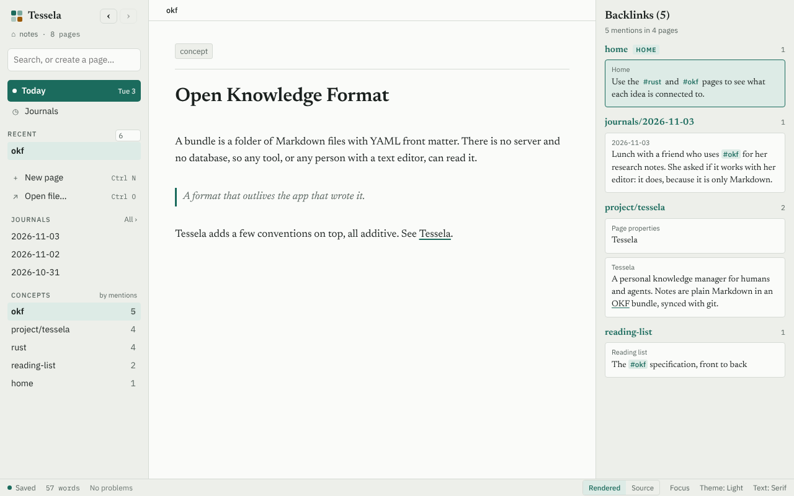
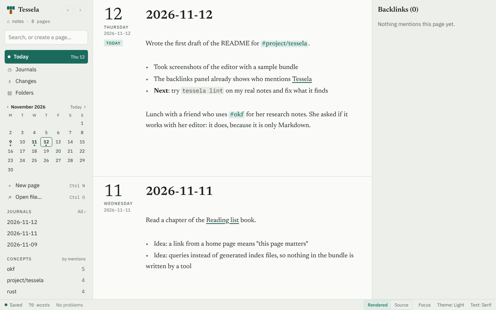
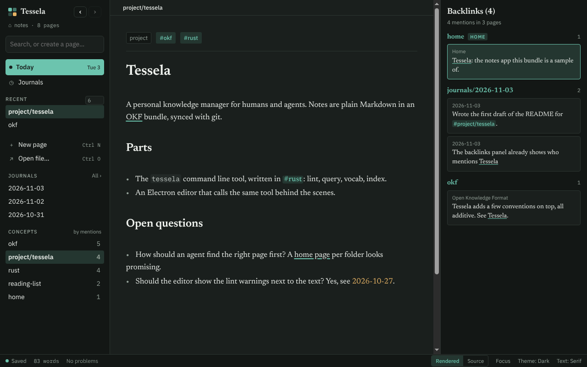

<p align="center">
  <picture>
    <source media="(prefers-color-scheme: dark)" srcset="assets/logo/tessela-mark-dark.svg">
    
  </picture>
</p>

<h1 align="center">Tessela</h1>

<p align="center">A personal knowledge manager for humans and agents.</p>

Notes are plain Markdown in an [Open Knowledge Format](https://okf.md/) bundle,
synced with git. Rust tools lint, query and list the vocabulary of that bundle,
and import a Logseq graph. An Electron editor uses the same tools behind the
scenes.



- [Conventions](docs/conventions.md): what Tessela adds on top of OKF.
- [Agent skill](skills/tessela/SKILL.md): how an agent should work in a bundle, and which
  changes go through the `tessela` CLI.

## Tools

```
cargo run -- lint path/to/bundle            # text output
cargo run -- lint path/to/bundle --json     # for editors and agents
cargo run -- lint path/to/bundle --strict   # warnings fail too
```

`tessela lint` exits with 1 on errors (and on warnings with `--strict`), and 2
when the folder cannot be read. Rules are in
[`crates/tessela-core/src/lint.rs`](crates/tessela-core/src/lint.rs); each one
implements the `Rule` trait, so more can be added without touching the others.

| Rule                        | Severity | Checks                                                   |
| --------------------------- | -------- | -------------------------------------------------------- |
| `okf/frontmatter`, `okf/type` | error  | Every concept file has valid frontmatter and a `type`    |
| `okf/readable`              | error    | Files are valid UTF-8                                    |
| `tessela/dates`             | warning  | Datetimes use a space instead of `T` and have an offset  |
| `tessela/journal`           | warning  | Journals are at `journals/YYYY-MM-DD.md` with that `date` |
| `tessela/vocabulary`        | warning  | Deprecated terms and aliases from `vocabulary.md`        |
| `tessela/unwritten-concept` | info     | Concepts mentioned but without a page yet                |

### Query

```
tessela query . --ref rust                       # blocks that mention #rust
tessela query . -r rust -r tessela               # ... both (use --any for either)
tessela query . -r tessela --own                 # only the block's own refs
tessela query . --text linter --type journal     # text and page type
tessela query . --from 2026-10-01 --to 2026-10-31 --json  # journal days and mentioned dates
tessela query . --page project/ --limit 20       # one page, or a folder with `/`
```

`tessela query` is the backlinks engine: ask for a concept and get everything
that mentions it. A hit has a `kind`:

- `block`: a paragraph or list item. It matches when it, one of its parent list
  items, or a heading above it mentions the concept (spec §3); `--own` turns that
  inheritance off.
- `heading`: a heading that mentions the concept. The blocks under it match as
  well, since they inherit its refs.
- `page`: a page that mentions the concept in its frontmatter, through `tags` or
  through links and `#tags` written in other frontmatter text.

Headings and pages only exist to hold references, so they are returned only when
the query names a concept with `--ref`.

A concept also matches the ones nested under it, so `--ref project` finds
`#project/tessela`. A name that a page lists in its frontmatter `aliases` finds
that page's backlinks too. A date range (`--from`, `--to`) keeps what is on
journal days in the range and anything, on any page, whose text contains a date
in the range.
Every hit has a `handle` that stays the same until the text changes, plus its
page, line, heading path, refs and parent handle. Text output is for people;
`--json` is for agents and the editor: the answer is
`{"api": 2, "ok": true, "hits": [...], "total": N}` (`vocab` answers with `concepts`,
`lint` with `diagnostics`), and `--api 2` makes the tool refuse when it speaks another version.

### Pages

```
tessela pages . --json     # every page: id, path, title, type
```

### The API

```
tessela schema             # every command, its arguments and the JSON Schema of its answer
```

### Watching

```
tessela watch . --json     # one line per burst of changes: {"event":"changed","paths":["a.md"]}
```

A read-only stream for tools that keep a view of the bundle. Hidden folders and other
files are not reported; `--poll` looks at the files instead of asking the system.

### Vocabulary

```
tessela vocab .                    # concepts by number of mentions
tessela vocab . --unwritten        # mentioned, but no page yet
tessela vocab . --prefix project/  # one namespace
tessela vocab . --min-count 3 --json
```

Lists every concept that has a page, is mentioned by a tag or link, or is
declared in `vocabulary.md`, with its mention count, how many pages mention it,
whether it has a page, and any alias or deprecation from `vocabulary.md`. Use it
to pick an existing term instead of inventing a new one.

### Changing pages

```
tessela read -b ~/notes project/tessela.md --json    # text + hash (or a template when new)
tessela add -b ~/notes "Machine Learning"            # new page from the template
tessela save -b ~/notes project/tessela.md --expect HASH < new-text.md
tessela save -b ~/notes project/tessela.md --expect HASH --patch < changes.diff
tessela rename -b ~/notes ai/llm.md Models           # tags and links that name it follow
tessela move -b ~/notes ai/models.md archive/ --dry-run
tessela remove -b ~/notes ai/old.md --expect HASH    # says who still mentions it
```

This is the one door for edits: the editor saves through it, and so should agents.
A `save` names the hash it read (`--expect`, or `new` for a page that must not exist
yet) and fails with exit code 3 and a `conflict` error when the file has changed
since, so nothing is overwritten blindly. Writes are atomic. `--patch` takes a unified
diff that must apply exactly, for fine-grained changes. `rename` and `move` rewrite
the tags and links that name the page in every page, and keep the moved page's own
relative links pointing where they did. With `--json` every answer, errors included,
is `{"api": 2, "ok": true|false, ...}`; `--api 2` makes the tool refuse when it speaks
another version. The files stay the source of truth: every call reads the disk, so
edits made with vim or git are seen. Spec §9 has the rules.

### Import from Logseq

```
tessela import-logseq ~/logseq-graph ~/notes    # writes a new bundle in ~/notes
tessela lint ~/notes                            # then check it
```

Reads a Logseq graph and writes a Tessela bundle: pages and namespaces become
files, journals become `journals/YYYY-MM-DD.md`, top-level bullets become
paragraphs with their sub-bullets as a list beneath, `[[links]]` and properties
become tags and links, and block references are inlined. It prints a report of
what it converted and what it skipped, and never writes into a folder that has
files or changes the graph. The full mapping is in spec §12.

## Editor

```
cargo build                       # the editor calls the `tessela` binary
cd editor && npm install && npm run build
npm start -- --bundle ~/notes     # or choose the notes folder from the welcome screen
```



The folder you open is the root: pages, links and tags are all relative to it. Its
name and path sit at the top of the sidebar; click it (or Ctrl+Shift+O) to switch.
Ctrl+N makes a new page and Ctrl+O opens a Markdown file.

Opens on the latest journal days, saves as you type, shows backlinks, searches the
text of your notes, lists what `tessela lint` finds, suggests existing tags, and
turns a selection into a link with Ctrl+L (Super+L on macOS), searches the pages for a link
after Ctrl+L or a single `[` and a few letters, and turns selected text into a link when you
paste an address over it. The **Rendered** button
(Ctrl/Cmd+Alt+M) shows the Markdown rendered and switches to the raw text only in the
block you are editing. Details are in spec §11. `npm test` runs the unit tests and `npm run e2e` drives a real window, and `npm run e2e:acceptance`
checks every feature of the editor there (`ONLY=regex` runs some of them).

The editor also has a dark theme, which follows the system until you choose one:



The screenshots come from a small sample bundle; `npm run screenshots` in `editor/` takes them
again (`xvfb-run -a npm run screenshots` on a server).

### Mods

The editor can be extended with mods: a folder `mods/NAME/` with a `main.js` in the config folder
(`$TESSELA_CONFIG`, else the app's data folder, `~/.config/Tessela` on Linux). Mods are trusted
code (your own or audited) and load before the first page opens; `--no-mods` starts without them,
and one that throws is skipped and listed under "Show the mods" in the palette (Ctrl+K).

```js
// mods/stamp/main.js
export default function (ctx) {
  ctx.commands.add({
    id: "stamp", label: "Stamp the page", keys: "Mod-Alt-j",
    run: ({ view }) => view.dispatch({ changes: { from: view.state.selection.main.head, insert: "STAMPED" } }),
  });
  ctx.slash.add({ label: "Signature", text: "-- me" });
  ctx.editor.extend(ctx.cm.view.EditorView.editorAttributes.of({ "data-mine": "yes" }));
  const n = ctx.settings.get("runs") ?? 0;            // kept with the window's settings
  ctx.cli(["vocab"]).then((r) => console.log(n, r.concepts.length));  // any tessela command, on the open folder
}
```

A command with the id of a built-in one takes its place. Notes change only through `ctx.cli`
(`save`, `rename`, ...), so the hash check and atomic writes always apply.

Mods can also draw on the window and hear what happens in it:

```js
ctx.ui.dialog({ title, content: node, actions: [{ id: "ok", label: "Go", primary: true }] }).closed  // the id pressed, or null
ctx.ui.toast("Saved somewhere", { label: "Undo", run })      // a note in the sidebar, with a button
ctx.slots.add("page-menu", { label: "Do it…", run: ({ path }) => {} })  // the ⋯ menu in a page's head
ctx.events.on("title-edited", ({ path, from, to }) => {})    // also page-opened, page-saved, changed
ctx.pages.current(); ctx.pages.moved(from, to)               // the page shown; after a rename, move or delete
ctx.pages.open("notes/idea.md", 12)                          // show a page (at a line), as a link would
ctx.fences.add("tessela", async ({ body, path }) => node)    // draw what is under a closed ``` fence of that info string
ctx.slots.mount("sidebar").root                              // an element in the sidebar, above the recent pages
ctx.backlinks.add(async ({ path }) => ({ node, first: true, taken: [handle] }))  // a group in the backlinks of the open page
```

The app's own features are mods too (`editor/src/mods/NAME/main.ts`, built to `dist/mods`), and a mod
of the same name in the config folder replaces them. `pages` renames, moves and deletes the open
page ("Rename page…", "Move page…" and "Delete page…" in the palette and in the page's ⋯ menu), shows
what will change first, and offers to rename the file when its title was edited.
`fold` folds and zooms (Ctrl+Up and Ctrl+Down, Ctrl+Alt+Right and Left; see conventions §11): it keeps
which blocks are folded in its settings, by page, and never in the notes. `live-lists` draws
the ```` ```tessela ```` fences of the conventions (`tessela fence`) as rows under the fence, asks again when
the notes change, and opens the page of a row when it is clicked; nothing it draws is written to the page.
`unlinked` lists, under the backlinks, the places in other pages that name the open page in plain words
(`tessela query --unlinked`), each with a Link button that writes the link through `tessela save`;
it draws into `ctx.slots.mount("side-bottom")`, the element below the backlinks.
`agenda` turns plain `- [ ]` items and the dates written in them into an agenda: a journal day lists the
open tasks that name it in a "Due" group at the top of its backlinks (today also lists the overdue ones),
ticking a task on its tile is written as a one-line patch through `tessela save --patch`, and a month
strip in the sidebar marks the days that have a file and the days that are only mentioned.
`outline` lists the headings of the open page as a group at the top of its backlinks (a click puts the cursor on
one; it is drawn from the saved page, so it follows once the page is saved), adds "Go to heading" to the
palette, and makes Alt+Up and Alt+Down on a heading line move its section (what is under it, down to the
next heading of its level) past the neighbour of the same level, without moving it out of its parent.
`search` replaces the search under the sidebar's search box (through `ctx.override.add("search", ...)`): words in
any order, "quoted phrases", `#tag`, `type:`, `in:`, `from:`/`to:` and a bare `YYYY-MM-DD` become one `tessela query`,
page titles and headings are searched with the text, the command is shown, and "Keep as live list" puts it in the
open page as a ```` ```tessela ```` fence.
`changes` is the "Changes" row in the sidebar: what differs between the notes and git (the last commit, or
any revision typed in, `ORIG_HEAD` for before the last pull), block by block, from `tessela changes`. Each
change is kept (hidden, nothing written; the window remembers) or put back (the page is saved again without
it through `tessela save`); a new page can be deleted and a deleted one written again. A mod can hand
`ctx.editor.extend` a function instead of an extension, to be called for each editor with `{ path }`,
the page that editor shows.
`new-page` takes the place of the window's name box for New page (Ctrl+N, the sidebar button, the palette):
it asks for a name and a type, the types being the bundle's `templates/NAME.md` with "Page" first, and
makes the page with `tessela add NAME --type TYPE`. A mod's command with the id `new-page` replaces it.
`gfm-extras` draws the GitHub-flavored Markdown the editor did not: `> [!NOTE]` (also TIP, IMPORTANT, WARNING,
CAUTION) as a callout, footnotes (`[^1]` as its number, numbered by first use, with the note as its tooltip; a click goes to
the definition and back), `$x$` inline math and `$$` blocks, and ```` ```math ```` and ```` ```mermaid ```` fences as
formulas and diagrams under the source. Where the cursor is, the Markdown shows as written, and nothing it draws is written
to the page, so the page reads the same on GitHub. KaTeX (as MathML, so no fonts) and Mermaid are loaded the first time a
page has one. Its palette commands are "Copy link to this heading" (`[Text](/page.md#anchor)`, which the editor follows),
"Copy as quote" (the selection, or the line, as a quote with a link to its page) and "Insert footnote"; the `/` menu has
Callout, Math block and Diagram.

To build an app that carries its own `tessela` binary:

```
cd editor
npm run package        # installer for this OS in editor/release/
npm run package:dir    # just the unpacked app, for trying it
```

That gives an AppImage and a deb on Linux and a dmg on macOS. The
[Release workflow](.github/workflows/release-editor.yml) builds all of them (Linux, and macOS
for Apple silicon and Intel): run it from the Actions tab, or push a tag such as
`v0.1.0` (matching `editor/package.json`) to attach them to a GitHub release. The
macOS app is not signed with an Apple certificate, so the first time, open it with
right-click, Open, or run `xattr -dr com.apple.quarantine /Applications/Tessela.app`.

## Releases

Pushing a tag like `v0.1.0` builds the `tessela` command line tool for Linux
(x86-64, static) and macOS (Apple silicon and Intel) and attaches
`tessela-<tag>-<target>.tar.gz` files, with checksums, to the GitHub release.
The workflow can also be run by hand from the Actions tab for an existing tag.

## Development

```
cargo fmt --all
cargo clippy --workspace --all-targets -- -D warnings
cargo test --workspace
```
